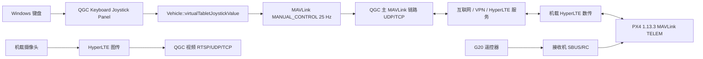

# HyperLTE 4G 图数传与 Windows 键盘控制链路评估

评估日期：2026-11-26。对象：`QGC4.4` 分支 `feature/keyboard-joystick`、PX4 1.13.3、机载 HyperLTE、Windows QGC、现有云卓 G20→SBUS/RC。此次仅审查本地源码与官方 PX4 文档，没有连接 HyperLTE、PX4 1.13.3 飞控或真实飞机，也没有修改控制代码或飞控参数。

## 初步结论

**方案有条件可行，但“数传和视频能从飞机传到电脑”不足以证明键盘能控制飞机。** HyperLTE 必须提供从 Windows QGC 到飞控 MAVLink 串口的低延迟、持续、双向传输；飞控还必须接受 `MANUAL_CONTROL` 并明确处理与现有 SBUS/RC 的输入优先级。视频流可独立接入，不承载键盘控制。

## 源码核查

1. `src/FlightDisplay/KeyboardJoystickPanel.qml:31-35,69-105`：用户主动启用并保持窗口焦点后，40 ms 定时器将 W/S/A/D/方向键转换为油门、偏航、俯仰和横滚，调用 `vehicle.virtualTabletJoystickValue(roll,pitch,yaw,throttle)`。本地连接丢失、切换车辆、失焦、本机已启用游戏手柄或触摸摇杆时停控。
2. `src/Vehicle/Vehicle.cc:2547-2558,4434-4467`：复用原 QGC 发送路径，从车辆主链路发 MAVLink `MANUAL_CONTROL`；若主链路无效或被标记为 High Latency，则不发送。该消息不是 Offboard 速度指令，也没有逐条确认。
3. `src/comm/UDPLink.cc:140-160,171-214`：UDP 链路把数据发给配置的目标及曾向本机端口发包的会话目标。需要确定 HyperLTE 到电脑的实际源 IP/端口和电脑回包目的地；单向视频/遥测或云平台只读接口不能直接支持键盘回传。该实现会自动加入任何发包端，因此生产环境应限制网络访问并确认目标，避免公网裸露。
4. `src/comm/TCPLink.cc:111-135`：QGC 也能主动连接可达的 TCP 主机/端口。4G 常有运营商 NAT，具体使用 TCP、UDP、VPN 或厂商中继取决于 HyperLTE 的接口，不能仅凭电脑“联网”推定端到端可达。
5. `src/Settings/Video.SettingsGroup.json:7-33` 和 `src/VideoManager/VideoManager.cc:729-739`：视频可配置 UDP、RTSP、TCP 等源；仍需确认 HyperLTE 输出的编码、协议、地址、端口和延迟。
6. `src/Vehicle/VehicleLinkManager.cc:30-44,98-149`、`.h:95`：QGC 根据接收的 MAVLink 消息判断通信状态，约 3.5 秒无消息标记链路丢失。该判断不能证明上行键盘消息已到飞控；若只有上行故障而下行仍工作，面板可能继续发送。
7. `src/FlightDisplay/KeyboardJoystickPanel.qml:31-32` 的 `vehicle.joystickEnabled` 表示 QGC 本机手柄，不代表 PX4 的 SBUS/RC 状态。现有 G20 可能仍持续向飞控提供 RC 输入；必须在 PX4 侧明确控制源选择，避免把“QGC 已发包”误当成“飞控已采纳”。

## PX4 1.13.3 关键配置

- 官方 1.13 摇杆文档确认 QGC 通过遥测链发送 `MANUAL_CONTROL`，并强调需可靠、足够带宽的遥测链。`COM_RC_IN_MODE` 决定是否接受 MAVLink 摇杆；官方 1.13 参数表列出 `0` 仅 RC、`1` 仅 Joystick、`2` RC 与 Joystick 回退、`3` 先到先用并保持、`4` 禁用摇杆输入。**实际飞控参数值尚未读取。** 当前 G20 SBUS 保留时，不应直接设为 `1` 并假定仍可由 SBUS 接管。
- 需要在台架确认 `COM_RC_IN_MODE=2/3` 的实际切换行为，以及 G20 SBUS 正常、SBUS 断开、4G 断开、两者恢复时的输入归属。必要时先将键盘功能定位为独立测试/备用控制源，而非自动接管。
- PX4 1.13 的 `COM_RC_LOSS_T`、`NAV_RCL_ACT` 负责手动控制丢失；`COM_DL_LOSS_T`、`NAV_DLL_ACT` 负责任务中地面站数传丢失。若要求 4G 断开后中止任务并返航，应由飞控执行，例如核验并配置 `NAV_DLL_ACT=2`，不能依赖已经断线的 QGC 下发返航命令。若还有其他 GCS 心跳持续送到飞控，单独 4G 断开可能不触发通用数传失联保护。
- 若同时传视频，先测量上行控制包的时延、抖动、丢包以及视频占带宽时的恶化情况。QGC 当前 25 Hz 发包，PX4 1.13 `COM_RC_LOSS_T` 参数表默认 0.5 秒；不经测量不可声称 4G 足以用于手动飞行。

官方依据：<https://docs.px4.io/v1.13/en/config/joystick>、<https://docs.px4.io/v1.13/en/advanced_config/parameter_reference>、<https://docs.px4.io/v1.13/en/config/safety>。

## 需要硬件资料确定的项目

1. HyperLTE 的准确型号、硬件版本、固件版本及厂商使用手册/配置截图。未找到足以确认该具体型号双向 MAVLink 与视频输出接口的官方公开文档。
2. HyperLTE 数传端与 PX4 的物理连接：TELEM 几、串口波特率、PX4 对应 `MAV_x_CONFIG`/`MAV_x_MODE`/`SER_TELx_BAUD`；是否经机载伴随计算机转发。
3. Windows 端接入拓扑：厂商客户端或云中继、VPN、专网或公网地址；MAVLink 是 UDP 还是 TCP，电脑的监听/连接端口，是否有双向回传及访问控制。
4. 图传输出是 RTSP、RTP/UDP、TCP、WebRTC 还是厂商私有协议；编码 H.264/H.265、视频地址和端口、是否可直接在 QGC 播放。
5. G20→SBUS 是否保留作为安全备份，控制源切换的预期：键盘主用、SBUS 主用或需人工切换。请提供当前飞控 `COM_RC_IN_MODE` 等相关参数值。
6. 是否有其他地面站/接收机/伴随计算机持续给 PX4 发送 GCS 心跳；4G 单独失联时是否必须立即返航，还是所有地面站链路失联才返航。

## 下一阶段台架验证，不进行真实飞行

先以螺旋桨拆除的 PX4 1.13.3 台架或相同版本 SITL 建立 HyperLTE 数传与视频；抓取 QGC 出站和飞控入站的 `MANUAL_CONTROL`，读取 PX4 实际采用的手动控制输入，分别测 8 个键、多键组合、持续油门、SBUS/键盘切换、单向和双向断链；最后在 SITL 任务模式验证数据链路丢失触发返航。当前这些结果均未取得。

## 根据用户提供的两份资料更新

2026-11-26 收到《HyperLte 4G 模块使用教程 V2》PDF 和《HyperLte4G 模块与无人机通信适配技术报告》DOCX。以下是**文档中的说明或项目报告陈述**，尚非本次独立复测结果。

- 厂商教程第 12–16 页给出 PX4 TELEM1、`MAV_0_CONFIG=101`、`SER_TEL1_BAUD=57600`，QGC 选择 TCP，连接厂商服务器与模块专属 `62***` 数传端口；图传走另一个 `52***` 端口的 RTSP URL。该配置与当前 QGC 的 TCP 和 RTSP 接口匹配，预期不需要为 HyperLTE 另写 MAVLink 通信代码。
- 项目技术报告第 2–4 节称现有机载 HyperLTE 经 TELEM1、厂商云 TCP 建立双向 MAVLink 链路，保留 G20→SBUS/RC，并已完成静态地面站连接、接收遥测和接近 2 km 的地面端移动测试。该报告没有给出 `MANUAL_CONTROL` 从 QGC 发出、由飞控接收并成为当前控制源的抓包或飞控日志；因此**键盘经 4G 控制飞控仍未验证**。
- 用户当前记忆是 TELEM1 可能设为 115200，教程和项目报告均写 57600。必须从**当前飞控**读回 `SER_TEL1_BAUD` 和 `MAV_0_CONFIG`，并核对 HyperLTE 串口侧波特率；不能根据旧报告覆盖现有参数。
- 建立 QGC TCP 通讯连接时不要勾选 `High Latency`：`src/UI/preferences/LinkSettings.qml:210-212` 暴露此选项，而 `src/Vehicle/Vehicle.cc:4442-4444` 在主链路被如此标记时直接丢弃摇杆发送。这个选项是 QGC 的特殊链路模式，不是对 4G 实际时延的描述。
- 教程 FAQ 给出数传约 100–200 ms、配套图传约 200–300 ms 的经验值，同时明确 4G 有延迟和卡顿；这不是本机、本卡、本地运营商、本时段的实测时延。手动控制是否可用取决于时延上界、抖动和丢包，尤其视频并发时。
- 教程第 16 页的 RTSP 示例含默认摄像头凭据，不应将原始示例直接当生产密钥；连接信息应从实际设备读取并妥善保管。

当前可执行的下一步是用已编译的 Windows QGC 创建 TCP 数传连接和 RTSP 视频源，在不装桨的台架或同版本 SITL 中验证上下行；不能仅以画面和遥测正常判定键盘控制成功。不要公开分享实际模块专属端口、视频凭据或厂商账户。
