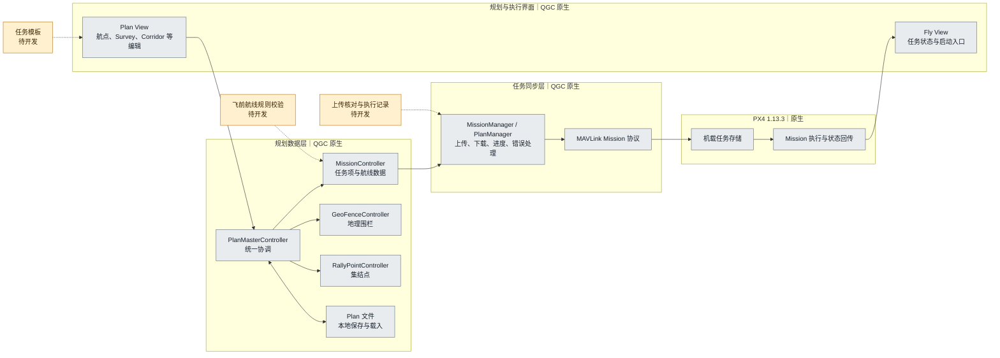
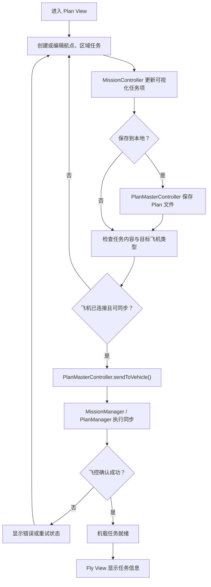
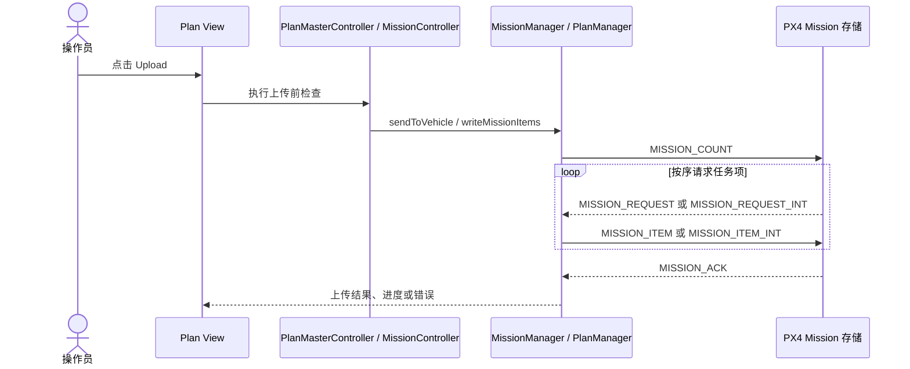
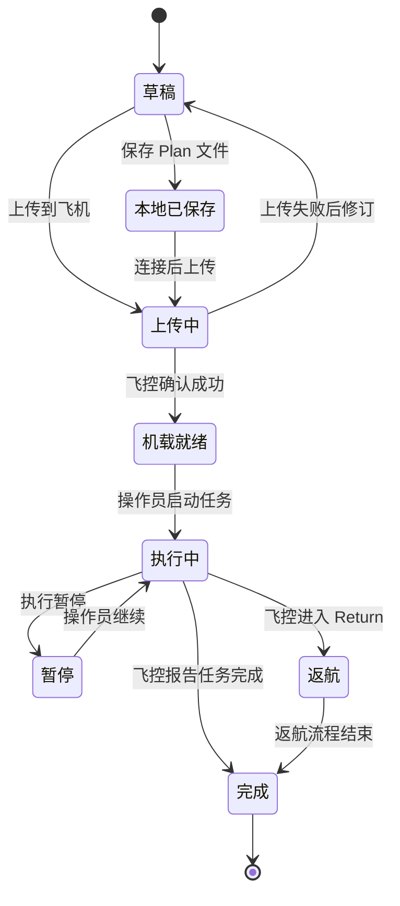

# QGC 4.4.5 航线任务架构与汇报材料

本版只讨论航线任务。所绘的 Plan View、MissionController、任务同步、Fly View 任务执行入口都是 QGC 4.4.5 原生功能；当前功能分支没有修改这些模块。图中的规划增强项均标为待开发。本项目已完成 QGC 源码编译与航线任务源码链路梳理；本材料不把原生航线功能记作新增代码。

## 可直接讲述的文本

本项目选择 QGroundControl 4.4.5 作为地面站基础平台。我对航线任务链路做了源码级分析：用户在 Plan View 中建立航点或区域任务，PlanMasterController 统一管理任务、地理围栏和集结点，MissionController 维护可视化任务项及航线数据。保存到本地时，规划数据由控制器序列化；上传至飞机时，MissionManager 和底层 PlanManager 通过 MAVLink Mission 协议与飞控同步，并处理进度、确认及超时错误。任务上传后，Fly View 使用 QGC 原有的任务入口展示和触发任务，飞控回传当前任务项与执行状态。

这次分析的工作重点是把界面、数据模型、传输协议和飞控执行分清楚，确定二次开发的插入点与验证边界。现阶段航线模块保留 QGC 原有实现，未声称重写航线规划算法或任务上传协议。下一阶段若要形成独立的航线功能增量，可以开发任务模板、飞前规则校验、上传结果核对、执行过程记录和任务中断恢复策略；这些增强需要分别实现、编译，并在 PX4 1.13.3 SITL 中验证。

## 图一：航线任务软件分层架构

灰色为 QGC/PX4 原生能力；黄色为待开发的航线增强模块。

## 图二：航线规划与上传业务流程

上图是 QGC 原生流程的简化表达；“检查任务内容”表示现有上传前检查，不代表本项目新增了独立的规则引擎。

## 图三：MAVLink 航线上传时序

## 图四：任务执行与状态监控逻辑

该状态图用于解释任务生命周期，不等同于 PX4 内部状态机的逐项代码实现；失联返航参数未在真实飞控上配置或测试。

## 源码核对位置

- `src/PlanView/PlanView.qml`：规划界面、上传前检查、本地保存与下载入口。
- `src/MissionManager/PlanMasterController.cc`：任务、地理围栏、集结点的协调，以及文件保存和飞机同步。
- `src/MissionManager/MissionController.cc`：任务项模型与航线数据处理。
- `src/MissionManager/PlanManager.cc`：MAVLink Mission 消息、超时与确认处理。
- `src/FlightDisplay/GuidedActionsController.qml`：Fly View 的任务启动与状态条件。

本材料只完成源码核对与说明整理；没有执行新的航线任务上传、PX4 SITL 或真实飞机测试。
